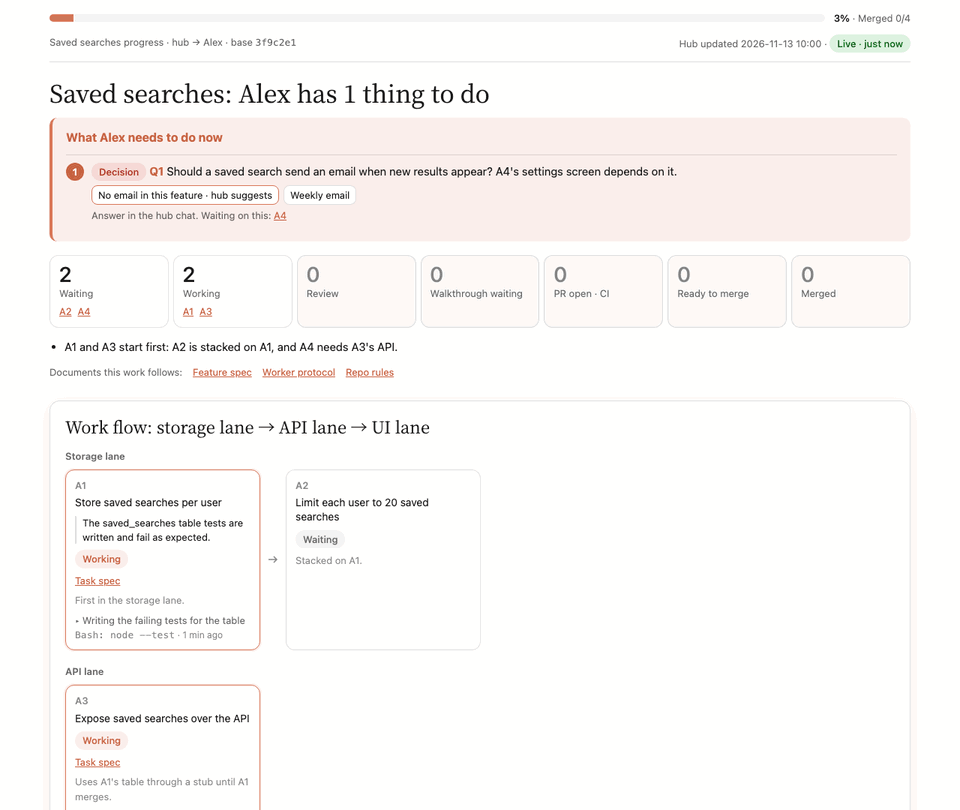
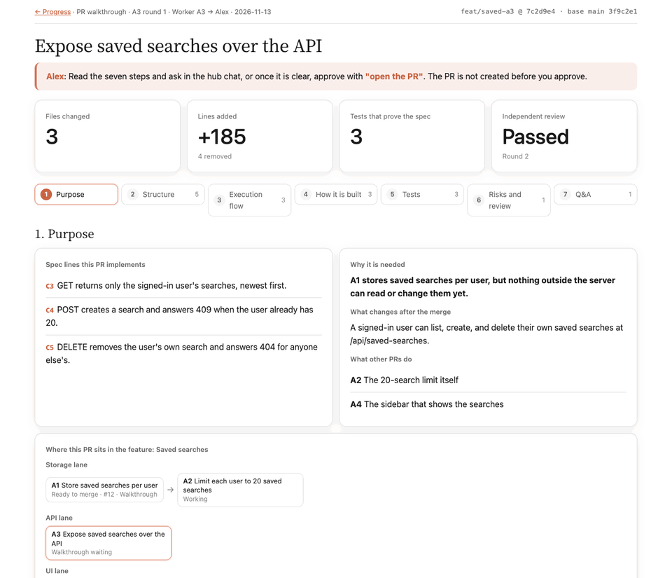
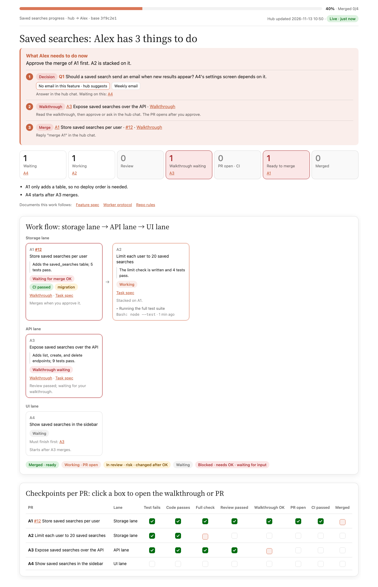

# Vera

Turn a feature you discussed with Claude Code or Codex into small, reviewed pull requests. Vera's hub splits the work into PRs, runs one worker session per PR in its own worktree, has each PR built test-first and checked by an independent reviewer, and walks you through the code before the PR opens. A live dashboard shows where every PR stands and what you need to do next.



Vera is a set of agent skills by ddevkim for work that is verified before it is called done. *Vera* is Latin for "true things", as in verify and verdict. `hub` is the first skill; more may be added.

| Skill | What it does |
|---|---|
| [hub](skills/hub) | Builds a feature you discussed with your agent as small PRs through worker sessions in Orca or the Claude desktop app, with an independent review, a walkthrough of each PR, and a live dashboard. |

**Contents:** [Prerequisites](#prerequisites) · [Install](#install) · [Start a hub](#start-a-hub) · [How it works](#how-it-works) · [Autonomy levels](#autonomy-levels) · [Claude desktop app](#in-the-claude-desktop-app) · [What the checks cover](#what-the-checks-cover) · [Update](#update) · [Uninstall](#uninstall)

## hub

### When a hub is worth it

- Use a hub when the work is two or more PRs (more than one outcome, or over the size target of ≤ 15 files / 300 changed lines, counting hand-written code and tests), and at least two of them can run at the same time or stack.
- Skip it for one small PR, or for work that cannot be split into PRs that merge alone. The hub says so and offers to do the work in your session instead.

### Prerequisites

- One place to run workers: the [Orca](https://orca.dev) app with its `orca` CLI and its `orchestration` skill, or the [Claude desktop app](https://claude.ai/download) (Code tab)
- `git`
- `gh`, logged in
- `node` 18 or newer

The skill installs nothing. It checks these itself before a hub starts, with one command you can also run:

```sh
node <skill folder>/scripts/preflight.cjs
```

It prints one `missing:` line per problem. A missing `orchestration` skill comes with the command that installs it: `orca skills install --skill orchestration`. In the Claude desktop app the hub adds `--runtime claude-app`, which checks the app instead of Orca.

The hub runs POSIX shell commands, so it needs macOS or Linux; the check does not look at the system.

A worker runs as you, with your account's access. Read [What the checks cover](#what-the-checks-cover) before you start a hub.

### Install

**Claude Code**, inside a session:

```text
/plugin marketplace add marpple/vera
/plugin install vera@mco
/reload-plugins
```

Or from a terminal, then start a new session:

```sh
claude plugin marketplace add marpple/vera
claude plugin install vera@mco
```

`mco` is the marketplace this repo publishes for Marpple's agent plugins, and `vera` is the plugin in it.

**Codex:**

```sh
codex plugin marketplace add marpple/vera
codex plugin add vera@mco
```

**Other agents**, with the `skills` CLI:

```sh
npx skills add marpple/vera --skill hub
```

> [!NOTE]
> Installed Vera from `ddevkim/vera` before? Remove that install first, as [Moving from ddevkim/vera](#moving-from-ddevkimvera) shows.

### Start a hub

1. Discuss the feature with your agent until you agree on what to build: in an Orca terminal, or in a Claude desktop app session.
2. Invoke the skill: `/vera:hub` in Claude Code (`/hub` when installed with `npx skills`), `$vera:hub` in Codex (`$hub` when installed with `npx skills`). In another agent, ask it to use the hub skill.

In Orca, the sidebar shows the hub's workspace as one entry named after the feature, with every worker beneath it. Run the hub from any Orca terminal: when the terminal belongs to no workspace, the hub uses the repo's main workspace. When the hub closes, it gives that workspace its old name back.

The hub then asks you for:

- confirmation of the spec it wrote from your discussion,
- once, whether to keep its run defaults (the worker agent, how many workers run at a time, the PR assignee),
- product decisions it should not guess,
- a walkthrough of each PR before the PR opens,
- approval of each merge,
- permission prompts in worker terminals.

That list is the **Low** autonomy level, the default.

### How it works

Once you invoke it, your session becomes the hub: it writes the spec, splits the work into small PRs, and starts one worker per PR, each in its own worktree.


Every PR passes the same eight checkpoints, and the dashboard ticks each one off. The reviewer starts from a fresh context and did not write, plan, or split the code: by default it is a subagent the hub starts, never the hub itself and never the PR's worker.


Both pictures show the default level, Low. At Medium and High the hub approves the walkthrough itself, and at High it also merges: see [Autonomy levels](#autonomy-levels).

Each walkthrough is a page of seven steps: purpose, structure, execution flow, how it is built, tests, risks and review, and the questions you asked. At Low the hub explains it before the PR opens, and you approve it or ask in the hub chat until it is clear.



The dashboard opens in an Orca tab, or in the Claude desktop app's browser pane, and reads the hub's state again every few seconds. From the top, it shows what you need to do now, most blocking first; how many PRs sit at each stage; the lanes of PRs, with what each worker is doing right now; and one box per checkpoint for every PR, where the review and walkthrough boxes open the PR's walkthrough and the PR-open box opens the PR.



### Autonomy levels

Tell the hub at the start, or at any time, to run at another level.

| What | **Low** (default) | **Medium** | **High** |
|---|---|---|---|
| Product decisions | you answer | you answer | the hub decides by its recommendation and records it |
| Walkthrough | you approve it before the PR opens | the hub approves it once the review passes; you read it with the merge approval | the hub approves it once the review passes; the final report links it |
| PR opens | after your walkthrough approval | once the review passes | once the review passes |
| Merge | you approve each | you approve each | the hub merges on green CI |
| Deploy steps | you run them | you run them | the hub runs the steps the repo documents |
| Worker permission prompts | you answer each | workers push, open PRs, and delete files in their worktree without a prompt | as Medium |
| You hear from the hub | at every checkpoint | at every checkpoint | at a risky step, a blocked PR, and the end |

At High the hub stops only for risky steps, such as dropping data, spending money, changing secrets, or a PR that changes CI or the repo's rules, and waits for your answer. At every level, each PR is still built test-first, fully checked on its final code, and independently reviewed.

<details>
<summary>How the hub picks each worker's model</summary>

The hub picks each worker's model and reasoning effort itself and does not ask you. It looks up what the agent offers at each start, so a newly released model is used without a new version of this plugin. An ordinary item runs one family below the most capable model at `high` effort. A risky or foundational item goes one step up and a mechanical or docs-only one goes one step down, never more than one step. Name a model or an effort to the hub to override it.

</details>

### In the Claude desktop app

The hub also runs in a Claude desktop app session (Code tab), without Orca. It finds out where it runs by itself: when its session can start other app sessions, each worker is an app session in its own worktree, nested under the hub's session in the sidebar; otherwise it uses Orca as above. Everything else is the same: the spec, the split, TDD, the independent review, the walkthrough, the autonomy levels, and the dashboard.

- Install the plugin as for Claude Code, run `/reload-plugins` in the app session, then invoke `/vera:hub`.
- The dashboard opens in the app's browser pane from a local address the hub's sync serves, because the pane shows local files outside the project only as snapshots.
- Workers inherit the hub session's permission mode, and every worker is a Claude Code session: Codex workers need Orca.
- The hub folder is `.vera/workspaces/<repo>/_hub/<feature>/` in your home directory.

[skills/hub/references/claude-app.md](skills/hub/references/claude-app.md) lists how each Orca command maps to the app.

### What the checks cover

The independent review, the changed-lines hash the merge compares, and the allow list at Medium and High catch mistakes: a PR that changed after its review, a merge of a commit nobody read, a push to the wrong place. They are not a sandbox.

- A worker is an agent session that runs as you. It can reach what your account can: files outside its worktree, the hub folder with the hashes the review recorded, and your `gh` login.
- The allow list matches command text. A command it does not name, or one wrapped in a script, is decided by the session's own permission mode.
- CI runs every push, including a fix pushed before the next review round reads it. Keep secrets that such a run must not use behind what your repo already protects, such as environments or protected branches.

Run a hub on a repo, and with instructions, you would give an agent session anyway.

### Language

The dashboard and the walkthrough page show their labels in Korean or English, from `lang` (`"ko"` or `"en"`) in the hub's `state.js`. The skill creates that file in its hub folder, `<workspaces root>/_hub/<feature>/state.js` (by default `$HOME/orca/workspaces/<repo>/_hub/<feature>/`).

### Update

Claude Code can update Vera on its own, but third-party marketplaces such as this one start with auto-update off. Turn it on once on each machine: in a Claude Code session run `/plugin`, open the **Marketplaces** tab, select `mco`, then **Enable auto-update**. Claude Code then checks for a new version in the background after a session starts. The running session keeps its version until you run `/reload-plugins`, and the next session loads the new one. If `DISABLE_AUTOUPDATER=1` or `DISABLE_UPDATES=1` is set, the toggle is hidden; set `FORCE_AUTOUPDATE_PLUGINS=1` as well to keep plugin updates.

To update by hand instead (restart the session after):

```sh
claude plugin marketplace update mco
claude plugin update vera@mco
```

Codex has no auto-update: run these after each release, once in each `CODEX_HOME` you use:

```sh
codex plugin marketplace upgrade mco
codex plugin add vera@mco
```

npx skills:

```sh
npx skills update hub
```

### Uninstall

Claude Code:

```sh
claude plugin uninstall vera@mco
claude plugin marketplace remove mco
```

Codex:

```sh
codex plugin remove vera@mco
codex plugin marketplace remove mco
```

npx skills:

```sh
npx skills remove hub
```

### Moving from ddevkim/vera

Vera was first published in a marketplace named `vera` at `ddevkim/vera`. That marketplace is deprecated and gets no more releases. Remove the old install, then [install](#install) again. The skill keeps its name, `/vera:hub`, and a hub folder you already have is not touched.

Claude Code:

```sh
claude plugin uninstall vera@vera
claude plugin marketplace remove vera
```

Codex:

```sh
codex plugin remove vera@vera
codex plugin marketplace remove vera
```

An install made with `npx skills` has no marketplace: run `npx skills remove hub`, then add the skill again.

## Releasing

For maintainers, and for an agent asked to release. A merge to `main` does not reach anyone's install: Claude Code and Codex keep the plugin in a cache named by its version, so installs stay on the old copy until the version changes.

1. Open a pull request that changes only `version` in `.claude-plugin/plugin.json`, titled `Release X.Y.Z`, and list in its body the pull requests merged since the last release. Use a patch version for fixes and a minor version when the skill gains something (a script, a rule, a place it runs).
2. Merge it once CI passes and a reviewer has approved. `.github/workflows/release.yml` then tags the merge commit and publishes the GitHub release, as this would by hand:

   ```sh
   gh release create vX.Y.Z --target <full hash of the merge commit> --title "X.Y.Z" --generate-notes
   ```

   The generated notes list the merged pull requests. Rewrite them to say what changed for a user: `gh release edit vX.Y.Z --notes-file <notes.md>`. Installs do not read the tag: they read the version in `main`. The tag and the release are the history people see on GitHub. Releases before 0.3.0 have neither.
3. Update your own installs as in [Update](#update), then check that each one shows the new version (`claude plugin list`, `codex plugin list`):
   - Claude Code updates one scope per run. With the plugin installed in both, run `claude plugin update vera@mco --scope user` and `claude plugin update vera@mco --scope project`.
   - Codex: once in each `CODEX_HOME` you use.
4. A session that was already running keeps the old version until `/reload-plugins` or a restart.

## Contributing

Issues and pull requests are welcome. [CONTRIBUTING.md](CONTRIBUTING.md) describes the steps from an issue to a merge, and [SECURITY.md](SECURITY.md) says how to report a vulnerability.

## License

[MIT](LICENSE)
